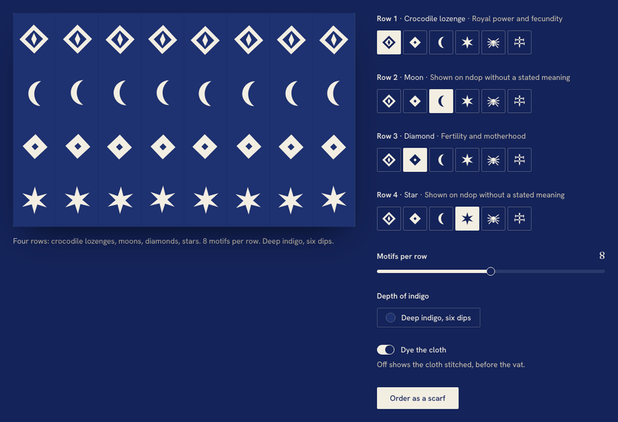

# Launch note: Atelier Ndop

Page 01 of Motifs, at [motifs.valerymelou.com/atelier-ndop/](https://motifs.valerymelou.com/atelier-ndop/). A fictional indigo atelier in Foumban, and the story of ndop, the cloth Ndop UI is named after.

## What's special

- **Green, then blue.** Indigo comes out of the vat green and turns blue in the air. The hero opens on that moment: two photos of one dip crossfade from green to blue, in CSS, before any JavaScript runs.
- **Design your own cloth.** The pattern maker draws a live SVG cloth from a typed model. Pick a motif for each of four rows, set the density and the depth of indigo, then watch the stitched cotton dye green and turn blue. Order it as a scarf by email. Every motif and its meaning is one a museum or study records on ndop.
- **The story, checked.** Where ndop comes from, how it is made, worn and mourned in, and what its motifs mean, from sources that agree, with the sources linked.
- **Moves with the scroll, for free.** The header slims, the indigo rises into the pattern maker, a raffia stitch runs along the steps and the vat turns as it passes. All of it is CSS scroll-driven animation: no JavaScript, transform and opacity only, and still for anyone who asks for reduced motion.
- **Fast on a slow phone.** LCP 1.7 s on Lighthouse's throttled mobile profile, CLS 0.001, 99–100 performance, 100 accessibility. Phones get square crops of the hero, and the blue frame waits until the green has loaded.

## Ndop items

`toggle-group` (with `toggle`), `tooltip`, `slider`, `popover`, `switch`, `label`, `dialog`, `button` and `card`. They are restyled through tokens, and turned around for the vat's night inside the pattern maker. The few edits to the copied files, and the Ndop gaps they work around, are in the [app README](../../apps/atelier-ndop/README.md).

## Built with

Angular 22 and Ndop UI 1.1, prerendered to static HTML. Photos generated with Nano Banana from prompts on the art direction board. Designed and reviewed by Valery, implemented with AI coding tools.
