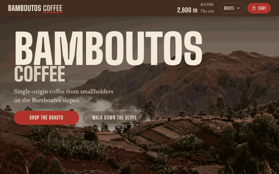

# Launch note: Bamboutos Coffee

Page 04 of Motifs, at [motifs.valerymelou.com/bamboutos-coffee/](https://motifs.valerymelou.com/bamboutos-coffee/). A fictional single-origin roaster that buys from smallholders on the slopes of the Bamboutos massif, in Cameroon's Western High Plateau.

## What's special

- **The page is the mountain.** It opens on the rim at dawn and walks down the slope to the roastery at the foot, where the shop is. An altimeter in the header counts the altitude down as you go: 2,600 m on the rim, 2,000 m at the plots, 1,400 m at the roastery.
- **Cherry to cup, down the slope.** The section pins while one bean walks down the slope's profile through five stations: the farms, picking, the washing station, the drying beds and the roastery. At each one the bean changes, from cherry to roasted bean, and a photo plate opens with its altitude on the mount. With reduced motion, it's five captioned figures.
- **Photographs, no faces.** Fourteen photos of the slope, the cherries, the picking, the drying beds, the roast and the bags, generated and reviewed for the series. The farmers are fictional, so they appear only through their hands and their plots, on a survey sheet with pins and taped field prints.
- **A roastery's details.** Each roast has its curve, the beans' temperature over the roast with first crack and the drop, drawn to one scale for all three. The brew guide gives grams, millilitres, degrees and minutes. The bags' labels are real text laid over blank bags.
- **A shop that works like one.** Choose a size and a grind, add to the cart, and a toast confirms it with Undo. The cart opens from the header as a side sheet, with quantities and a running total in FCFA. Nothing is sold: checkout ends at a note that the page is a design study.
- **Its own header and footer.** The header is the altimeter, whose Route button opens every stop with its altitude. The footer is the trailhead: a signpost whose boards are the series links, beside a benchmark plate.
- **Moves with the scroll, for free.** Every scene is CSS scroll-driven animation: no JavaScript, transforms and opacity on the compositor, and still for anyone who asks for reduced motion.
- **Fast on a slow phone.** LCP under 0.8 s on Lighthouse's throttled mobile profile, CLS 0.006, 100 for performance, accessibility, best practices and SEO, in 93 kB of JavaScript. The roasts, brew guide and shop load their code only as they scroll into view.

## Ndop items

`tabs`, `select`, `sheet`, `toast`, `badge`, `accordion`, `button` and `card`, restyled through tokens and the page's own classes. The edits to the copied files and the Ndop gaps are in the [app README](../../apps/bamboutos-coffee/README.md).

## Built with

Angular 22 and Ndop UI 1.1, prerendered to static HTML. The coffee facts come from sources the art direction board checked, chiefly the ICO's Cameroon profile, linked in the README; the roaster, its farmers, prices and roasts are fictional. Photographs generated with Nano Banana and reviewed by Valery. Designed and reviewed by Valery, implemented with AI coding tools.
