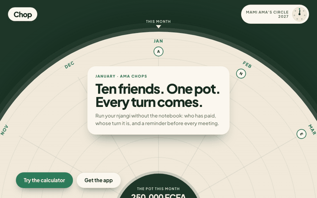

# Launch note: Chop

Page 03 of Motifs, at [motifs.valerymelou.com/chop/](https://motifs.valerymelou.com/chop/). A fictional mobile app from Bamenda for running a njangi, a rotating savings circle, with friends or colleagues. _Chop_ comes from "chop njangi", to take the pot.

## What's special

- **A year, not a stack of bands.** The page runs through one njangi year, Mami Ama's circle of ten in 2027, in seven sections you scroll straight through. Three of them pin while their scene plays and then let go, so the scroll is never taken away from you.
- **The year wheel.** A wheel of twelve months fills the first screen. The scroll turns it a month at a time, from the headline in January to how a njangi works, then on to October, each member's seat turning green as they take the pot. At the end it shrinks into the header's dial.
- **A header and a footer of its own.** The header is a dial whose hand follows the scroll and whose menu opens round a ring, a native popover that works without JavaScript. The footer is the closing ring: the store buttons inside it, the series facts round it.
- **A calculator drawn as a wheel.** One wedge per member, each as long as what they've paid in by their turn, inside a dashed ring for the pot. The first wedge is one payment long and the last reaches the rim: the arithmetic of a njangi, drawn. It reads by arrow key, as a table, and without JavaScript.
- **A month on a real-looking phone.** A 28-day dial turns round a phone drawn at true scale, from the March meeting to the April one. On five days the screen changes: the book, a swap to approve, a gift for a wedding, the reminder on the lock screen, and who has paid.
- **The treasurer's notebook.** As each row scrolls past, its biro mark is struck through and Chop's status is written over it.
- **Moves with the scroll, for free.** Every scene is CSS scroll-driven animation: no JavaScript, transforms and opacity on the compositor, and plain columns for anyone who asks for reduced motion or whose browser has no scroll timelines.
- **Fast on a slow phone.** LCP 0.75 s on Lighthouse's throttled mobile profile, CLS 0, 100 for performance, accessibility, best practices and SEO, in 96 kB of JavaScript.

## Ndop items

`slider`, `select`, `chart`, `accordion`, `toggle-group` (with `toggle`), `card`, `button` and `badge`, restyled through tokens and the page's own classes. The edits to the copied files, the wheel chart's workaround and the Ndop gaps are in the [app README](../../apps/chop/README.md).

## Built with

Angular 22 and Ndop UI 1.1, prerendered to static HTML. The njangi facts come from sources the art direction board checked, linked in the README; the app, its prices and its store buttons are fictional. Designed and reviewed by Valery, implemented with AI coding tools.
