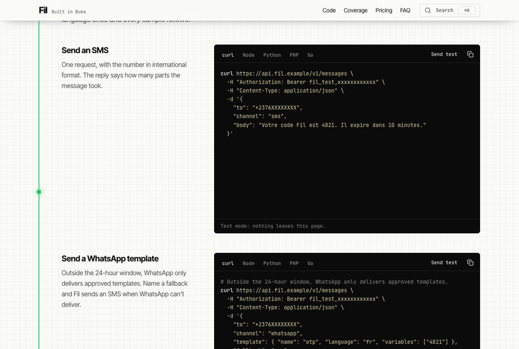

# Launch note: Fil

Page 02 of Motifs, at [motifs.valerymelou.com/fil/](https://motifs.valerymelou.com/fil/). A fictional developer API from Buea, the town called Silicon Mountain, that sends SMS and WhatsApp messages across Africa through one endpoint. _Fil_ is French for thread.

## What's special

- **One thread.** Black ink on squared paper, and one green thread. It steps out of the hero's terminal, runs down every section, knots once at each coverage region and ends at the footer in the stitch, the motif the index gives Fil.
- **A command palette.** ⌘K or Ctrl+K, or the header's button: jump to a section, switch every code sample's language at once, copy the test key or the base URL, or set the theme. All from the keyboard.
- **Code you'd write.** Three tasks in curl, Node, Python, PHP and Go, each with its language's own HTTP tooling. One language choice drives every sample and is remembered. They're highlighted with Shiki at build time, so the page ships no highlighter, and switching language never moves the page.
- **A segment counter.** Type a message to see its encoding, its length, how many parts it splits into and what it costs. When one character forces UCS-2, the counter names it.
- **Moves with the scroll, for free.** The hero's request types out and the reply arrives. A bead rides each section's run of thread, the header slims, countries pop in and prices roll up. All of it is CSS scroll-driven animation: no JavaScript, transform and opacity only, and still for anyone who asks for reduced motion.
- **Fast on a slow phone.** LCP 0.7 s on Lighthouse's throttled mobile profile, CLS 0, 97–98 performance, 100 accessibility, in 120 kB of JavaScript.

## Ndop items

`command`, `dialog`, `tabs`, `table`, `badge`, `accordion`, `toggle-group` (with `toggle`), `textarea`, `button` and `tooltip`. They are restyled through tokens, in light and dark. The few edits to the copied files, and the Ndop gaps they work around, are in the [app README](../../apps/fil/README.md).

## Built with

Angular 22 and Ndop UI 1.1, prerendered to static HTML. Code samples highlighted with Shiki. The SMS and WhatsApp facts come from sources the art direction board checked, linked in the README. Designed and reviewed by Valery, implemented with AI coding tools.
